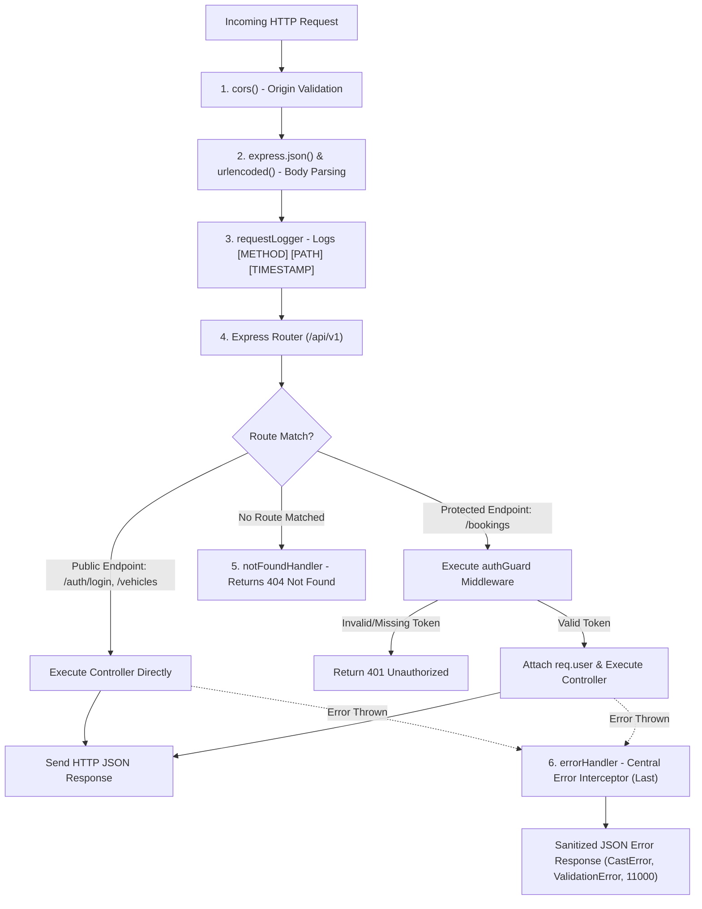

# DriveEasy Car Rental System

**Course:** ITUE301 Open-Book Practical Examination  
**Institution:** CSPIT, CHARUSAT  
**Development Stage:** Stage 4 — Express Backend REST API, Mongoose Models & Security Middleware  
**Architecture:** Full-Stack MERN (Node.js, Express, MongoDB, React, Vite)

---

## 📌 Project Overview

**DriveEasy Car Rental System** is an end-to-end full-stack web application designed for vehicle fleet browsing and reservations.
- The **Backend (Express + Node.js)** exposes standardized RESTful endpoints (`/api/v1`), connects to MongoDB via Mongoose models (`Customer`, `Vehicle`, `Booking`), enforces CORS, logs every request (`requestLogger`), authenticates against real bcrypt password hashes, and protects private operations via `authGuard` and role guards.
- The **Frontend (React + Vite)** provides a component-driven SPA interface with React Router DOM, state management via React Context (`{ customer, token }`), session persistence via `localStorage`, route protection via `ProtectedRoute`, and lazy loading via `React.lazy` and `Suspense`.

---

## 📡 REST API Endpoints Specification

### 1. `POST /api/v1/auth/login` (Public)
- **Description:** Authenticates customer credentials against real Customer record and bcrypt password hash. Returns signed JWT token and sanitized customer payload.
- **Status Codes:** `200 OK` (success), `400 Bad Request` (missing/invalid fields), `401 Unauthorized` (wrong credentials).
- **Sample Request Body:**
  ```json
  {
    "email": "customer@driveeasy.com",
    "password": "customer123"
  }
  ```
- **Sample Response (`200 OK`):**
  ```json
  {
    "success": true,
    "message": "Authentication successful. Welcome, Rahul Sharma (Customer)!",
    "data": {
      "customer": {
        "id": "654321654321654321000001",
        "name": "Rahul Sharma (Customer)",
        "email": "customer@driveeasy.com",
        "role": "customer"
      },
      "token": "eyJhbGciOiJIUzI1NiIsInR5cCI6IkpXVCJ9..."
    }
  }
  ```

---

### 2. `GET /api/v1/vehicles` (Public)
- **Description:** Retrieves fleet vehicles list as JSON. Supports optional category filtering via query parameter: `?type=SUV`, `?type=Sedan`, or `?type=Hatchback`.
- **Status Codes:** `200 OK`
- **Sample Request URL:**
  `http://localhost:5000/api/v1/vehicles?type=SUV`
- **Sample Response (`200 OK`):**
  ```json
  {
    "success": true,
    "count": 2,
    "filter": "SUV",
    "data": [
      {
        "_id": "654321654321654321000015",
        "model": "Mahindra Scorpio-N",
        "type": "SUV",
        "pricePerDay": 3500,
        "available": true,
        "registrationNumber": "GJ-05-IJ-7890",
        "fuelType": "Diesel"
      }
    ]
  }
  ```

---

### 3. `POST /api/v1/bookings` (Protected by `authGuard`)
- **Description:** Reserves a vehicle for the authenticated customer. Validates date formats, ensures `returnDate > pickupDate`, verifies vehicle availability, and sets vehicle `available = false`. Customer identity is strictly derived from the verified token (`req.user.id`).
- **Headers Required:** `Authorization: Bearer <jwt_token>`
- **Status Codes:** `201 Created` (success), `400 Bad Request` (invalid dates, return <= pickup, vehicle unavailable), `401 Unauthorized` (missing/invalid token), `404 Not Found` (vehicle not found).
- **Sample Request Body:**
  ```json
  {
    "vehicleId": "654321654321654321000015",
    "pickupDate": "2026-11-01",
    "returnDate": "2026-11-04"
  }
  ```
- **Sample Response (`201 Created`):**
  ```json
  {
    "success": true,
    "message": "Booking created successfully.",
    "data": {
      "_id": "671a5b8f...",
      "customerId": "654321654321654321000001",
      "vehicleId": "654321654321654321000015",
      "pickupDate": "2026-11-01T00:00:00.000Z",
      "returnDate": "2026-11-04T00:00:00.000Z",
      "days": 3,
      "totalPrice": 10500,
      "status": "reserved"
    }
  }
  ```

---

### 4. `GET /api/v1/bookings/my` (Protected by `authGuard`)
- **Description:** Retrieves all bookings belonging to the authenticated customer. Populates `customerId` with `name` and `email`, and `vehicleId` with `model` and `type`.
- **Headers Required:** `Authorization: Bearer <jwt_token>`
- **Status Codes:** `200 OK`, `401 Unauthorized`.
- **Sample Response (`200 OK`):**
  ```json
  {
    "success": true,
    "count": 1,
    "data": [
      {
        "_id": "671a5b8f...",
        "customerId": {
          "_id": "654321654321654321000001",
          "name": "Rahul Sharma (Customer)",
          "email": "customer@driveeasy.com"
        },
        "vehicleId": {
          "_id": "654321654321654321000015",
          "model": "Mahindra Scorpio-N",
          "type": "SUV"
        },
        "pickupDate": "2026-11-01T00:00:00.000Z",
        "returnDate": "2026-11-04T00:00:00.000Z",
        "days": 3,
        "totalPrice": 10500,
        "status": "reserved"
      }
    ]
  }
  ```

---

### 5. `PATCH /api/v1/bookings/:id/status` (Protected by `authGuard` & Role Guard)
- **Description:** Updates booking status. Allowed values: `reserved`, `ongoing`, `completed`, `cancelled`.
  - **Customer Role:** Permitted ONLY to cancel their own booking (`status: "cancelled"`).
  - **Fleet Manager / Admin Roles:** Permitted to update status to any allowed value.
  - Releasing vehicles: When status is set to `cancelled` or `completed`, the vehicle's `available` status is automatically restored to `true`.
- **Headers Required:** `Authorization: Bearer <jwt_token>`
- **Status Codes:** `200 OK`, `400 Bad Request` (invalid status), `401 Unauthorized`, `403 Forbidden` (customer attempting manager/admin transitions), `404 Not Found`.
- **Sample Request Body:**
  ```json
  {
    "status": "cancelled"
  }
  ```

---

## ⚙️ Middleware Execution Order (Viva Explanation)

In Express.js, middleware executes sequentially in the exact order declared in `app.js`:



1. **`cors()`**: First line of defense; validates the `Origin` header and configures HTTP access control before any data parsing.
2. **`express.json()` & `express.urlencoded()`**: Parses raw incoming byte streams into JavaScript objects available on `req.body`.
3. **`requestLogger`**: Global application logger running before all routes. Formats and prints `[METHOD] [PATH] [TIMESTAMP]` to the server console.
4. **`app.use('/api/v1', apiRoutes)`**: Modular API routing.
   - Public routes (`/auth/login`, `/vehicles`, `/health`) bypass `authGuard`.
   - Protected routes (`/bookings`) run `authGuard` before reaching the controller.
5. **`notFoundHandler`**: Catches any requests that did not match registered routes and returns a structured `404 Not Found` response.
6. **`errorHandler` (Always declared last with 4 arguments: `err, req, res, next`)**: Centralized error interceptor. Formats Mongoose `CastError`, `ValidationError`, duplicate key `11000`, and JWT errors into structured JSON without leaking stack traces.

---

## 🧪 Registered Test Accounts

| Role | Email | Password | Allowed Access |
|---|---|---|---|
| **Customer** | `customer@driveeasy.com` | `customer123` | View fleet, book available vehicles, view/cancel own bookings. |
| **Fleet Manager** | `manager@driveeasy.com` | `manager123` | View fleet, approve/update booking statuses, toggle fleet availability. |
| **Administrator** | `admin@driveeasy.com` | `admin123` | Full access across all collections and administrative actions. |

---

## 🚀 Running the Applications

### Start Backend Server:
```bash
cd driveeasy/server
npm run dev
```
> Server runs on `http://localhost:5000` with nodemon and database auto-seeding.

### Start Frontend Client:
```bash
cd driveeasy/client
npm run dev
```
> Client runs on `http://localhost:5173` with Vite.
