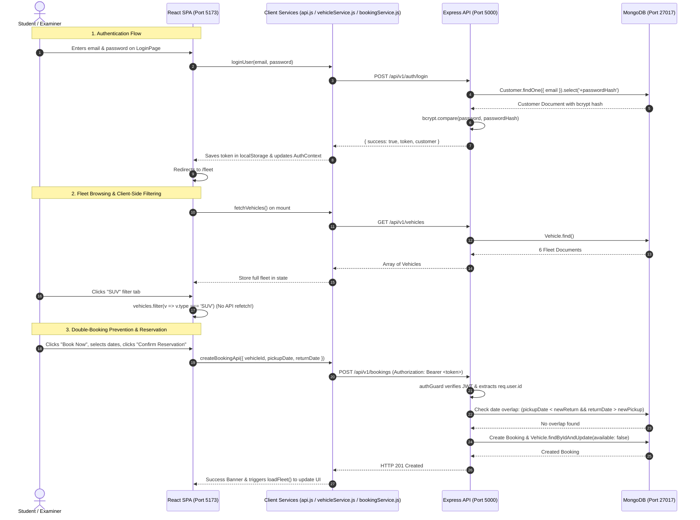

# DriveEasy Car Rental System

**Course:** ITUE301 Open-Book Practical Examination  
**Institution:** CSPIT, CHARUSAT  
**Development Stage:** Stage 6 — Full-Stack Frontend & Backend Integration  
**Architecture:** Full-Stack MERN (Node.js, Express, MongoDB, React, Vite)

---

## 📌 Project Overview

**DriveEasy Car Rental System** is an end-to-end full-stack MERN web application for vehicle browsing and reservations.
- **Backend (Express + Node.js + Mongoose):** Real MongoDB models (`Customer`, `Vehicle`, `Booking`), bcrypt password hashing, JWT Bearer tokens, CORS origin checking, global request logger (`requestLogger`), date-overlap double-booking prevention, transactions, populated queries, and role guards (`authGuard`, `roleGuard`).
- **Frontend (React 18 + Vite):** Component-driven SPA, React Router DOM, state management via React Context (`{ customer, token }`), session persistence via `localStorage`, route protection (`ProtectedRoute`), on-demand lazy loading (`React.lazy` + `Suspense`), and complete frontend-to-backend integration via dedicated service modules (`api.js`, `authService.js`, `vehicleService.js`, `bookingService.js`).

---

## 🚀 How to Run the Applications

### 1. Database Seeding (Seed MongoDB with Demo Fleet & Users):
Ensure your local MongoDB daemon is running on port 27017, then execute:
```bash
cd driveeasy/server
npm run seed
```
> Populates 3 demonstration accounts (Customer, Fleet Manager, Admin) and 6 fleet vehicles with real bcrypt password hashes.

### 2. Start the Backend API Server:
```bash
cd driveeasy/server
npm run dev
```
> Express server starts on **`http://localhost:5000`** with nodemon and live Mongoose connection.

### 3. Start the Frontend Client:
In a second terminal window:
```bash
cd driveeasy/client
npm run dev
```
> Vite dev server starts on **`http://localhost:5173`**.

### 4. Build Client Bundle:
```bash
cd driveeasy/client
npm run build
```
> Compiles all modules cleanly into `dist/` with `AdminPanel` code-split into its own lazy chunk (`dist/assets/AdminPanel-*.js`).

---

## 🔗 Frontend-to-Backend Integration Architecture



---

## 🛡️ Role-Based Access Control & Demonstration Accounts

The login page contains one-click test credential fill buttons for each role:

| Role | Email | Password | Permissions & Available Views |
|---|---|---|---|
| **Customer** | `customer@driveeasy.com` | `customer123` | View fleet, create reservations, view & cancel own bookings in **My Bookings**. Restricted from Admin Panel. |
| **Fleet Manager** | `manager@driveeasy.com` | `manager123` | View fleet, view all customer bookings, dispatch cars (mark `ongoing`), toggle fleet availability. |
| **Administrator** | `admin@driveeasy.com` | `admin123` | Full administrative control: all bookings, complete/cancel any booking, toggle fleet availability, and revenue insights. |

---

## 📡 Complete REST API Endpoints

| Method | Endpoint | Access | Function |
|---|---|---|---|
| `POST` | `/api/v1/auth/login` | Public | Authenticates credentials with bcrypt against MongoDB Customer record; returns signed JWT. |
| `GET` | `/api/v1/vehicles` | Public | Retrieves all fleet vehicles; supports `?type=SUV` filter. |
| `POST` | `/api/v1/vehicles` | `admin`, `fleetManager` | Adds a new vehicle to the fleet. |
| `PATCH` | `/api/v1/vehicles/:id/availability` | `admin`, `fleetManager` | Toggles vehicle availability flag in MongoDB. |
| `POST` | `/api/v1/bookings` | Authenticated (`authGuard`) | Reserves vehicle with interval date overlap check and transaction. |
| `GET` | `/api/v1/bookings/my` | Authenticated (`authGuard`) | Retrieves customer's bookings with populated `customerId` and `vehicleId`. |
| `GET` | `/api/v1/bookings` | `admin`, `fleetManager` | Retrieves all customer bookings across the platform. |
| `PATCH` | `/api/v1/bookings/:id/status` | Authenticated (`authGuard`) | Updates status (`reserved`, `ongoing`, `completed`, `cancelled`) with RBAC restrictions and vehicle release. |
| `GET` | `/api/v1/health` | Public | Live system health and MongoDB connection monitor. |

---

## 💡 Key Full-Stack Features Verified

1. **No Mock or Hardcoded Production Data:**
   - Both `FleetPage`, `MyBookingsPage`, and `AdminPanel` fetch 100% real MongoDB records via Express controllers.
2. **Client-Side Filter Optimization:**
   - On `FleetPage`, switching between *All, Hatchback, Sedan, SUV* filters the in-memory `vehicles` array using `.filter()` without triggering redundant HTTP requests.
3. **Double-Booking Prevention:**
   - Prevents overlapping reservations for the same car using mathematical date range intersection queries in MongoDB.
4. **401 Session Invalidation:**
   - When an expired or tampered token returns `401 Unauthorized`, `api.js` automatically clears `localStorage` and redirects the user to the login route.
5. **Role Restrictions on Both Ends:**
   - Frontend: `ProtectedRoute.jsx` blocks unauthorized navigation.
   - Backend: `authGuard.js` and `roleGuard` reject unauthorized HTTP calls with `401 Unauthorized` or `403 Forbidden`.
